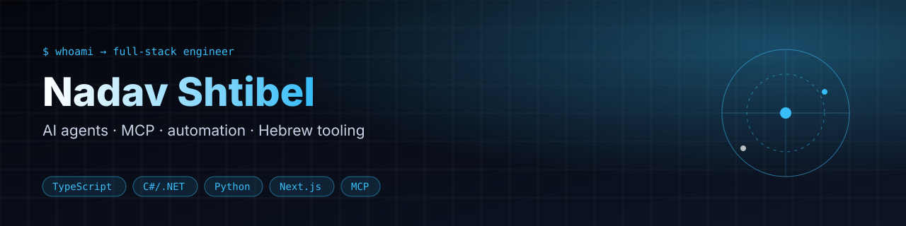

**Full-stack engineer building AI agents, MCP servers and production web systems — Hebrew/RTL-first.**
 שלום 👋 — I build tools that make agents reliable on real-world Israeli data.

---

### ⚡ What I work on

- **AI agents & MCP** — tool-using agents, Model Context Protocol servers, multi-agent pipelines, voice/messaging integrations.
- **Full-stack platforms** — Next.js, Angular and ASP.NET Core apps; multi-tenant backends; RTL/Hebrew UX.
- **Data & automation** — feed ingestion, entity resolution on noisy data, CI/CD with GitHub Actions and AWS Amplify.

### 🚀 Featured projects

<table>
<tr>
<td width="50%" valign="top">

#### [hebrew-il-mcp](https://github.com/Shtibel1/hebrew-il-mcp)
MCP server giving AI agents deterministic Israeli & Hebrew tools (v0.6.0, stdio or stateless Streamable HTTP): ת״ז / ח.פ validation, phone normalization, Israeli IBAN, plates, postal codes / city lookup (מיקוד), date-aware מע״מ, bank holidays / business days, Hebrew calendar, gematria.

`TypeScript` `MCP` `Zod` `Vitest`

</td>
<td width="50%" valign="top">

#### [il-opendata-mcp](https://github.com/Shtibel1/il-opendata-mcp)
MCP server for data.gov.il (CKAN) so agents can browse publishing ministries, search datasets, inspect resources and query datastore records. Runs over stdio or as a stateless Streamable HTTP service, with a hardened Docker image and one-click Render deploy.

`TypeScript` `MCP` `CKAN` `Streamable HTTP` `Docker` `open-data`

</td>
</tr>
<tr>
<td valign="top">

#### [Invoice Scan](https://github.com/Shtibel1/account-management)
Hebrew invoice OCR and validation pipeline for bookkeeping firms: multi-agent LLM extraction, VAT checks and a review UI.

`Next.js` `LangGraph` `Supabase` `AWS`

</td>
<td valign="top">

#### [Alex (סל חדרה)](https://github.com/Shtibel1/Alex)
Supermarket basket price comparison across 10 Israeli chains, built on the official Price Transparency XML/GZIP feeds, with fresh-produce matching and promo parsing.

`Python` `Vanilla JS` `GitHub Actions`

</td>
</tr>
<tr>
<td valign="top">

#### [DunFlow](https://github.com/Shtibel1/DunFlow)
Metadata-driven workflow engine: task types, transitions and required fields live in the database, so new workflows ship without code changes.

`.NET 9` `EF Core` `xUnit`

</td>
<td valign="top">

#### [InstallersApi2](https://github.com/Shtibel1/InstallersApi2) + [installers](https://github.com/Shtibel1/installers)
Multi-tenant field-service dispatch platform: JWT tenant routing, WebSocket updates, stock auditing, contractor settlements and an RTL Angular client.

`.NET 8` `WebSockets` `Angular`

</td>
</tr>
<tr>
<td valign="top">

#### [ChessApi](https://github.com/Shtibel1/ChessApi)
Object-oriented ASP.NET Core REST API for chess board state and piece-movement validation.

`C#` `ASP.NET Core` `OOP`

</td>
<td valign="top">

#### [il-basket-compare](https://github.com/Shtibel1/il-basket-compare)
Compare a grocery basket across Israeli supermarket chains using Price Transparency Law data on GitHub Pages.

`Python` `GitHub Pages` `open-data`

</td>
</tr>
<tr>
<td colspan="2" valign="top">

#### [il-consumer-agent](https://github.com/Shtibel1/il-consumer-agent) · [live demo](https://shtibel1.github.io/il-consumer-agent/)
Hebrew RTL customer-service agent for Israelis vs. large companies: classifies the issue, drafts a complaint citing consumer-protection law, tracks it through an SLA-aware state machine, and learns per-company playbooks from every outcome (persisted, de-duplicated learning loop).

`React 19` `TypeScript` `Zustand` `Vitest` `RTL`

</td>
</tr>
</table>

### 🧰 Stack

 

 

 

Built in Israel 🇮🇱 · תודה שעברת

